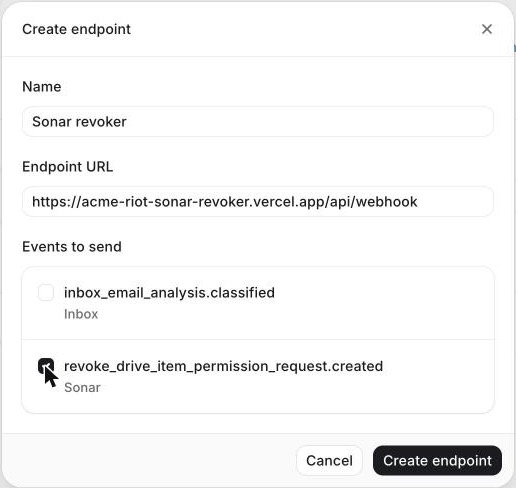
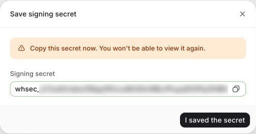
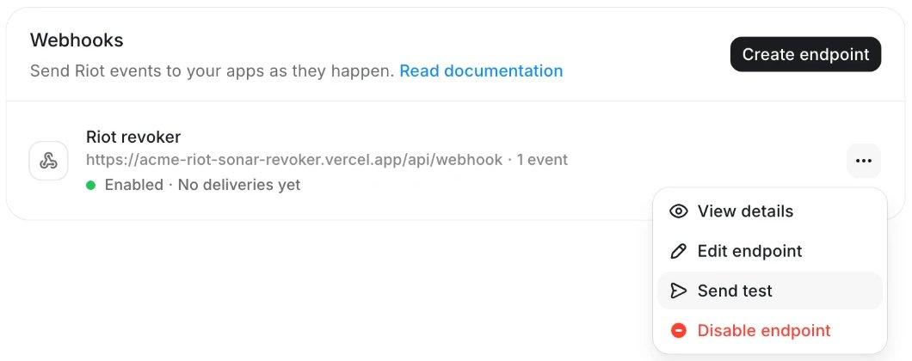

# Deploy on Azure

The receiver runs as a Function App in your own Azure subscription (Consumption plan, Windows, Node.js 22). It handles Microsoft 365 only and needs no Entra app and no client secret: it calls Microsoft Graph as the Function App's own managed identity, so nothing ever expires.

One script does the whole setup. It walks you through four steps, and you can stop and rerun it at any time: it picks up where it left off.

## Before you start

- **An Azure subscription** where you are Owner or Contributor. Usage stays within the Consumption plan's free grant for normal revocation volumes.
- **An Entra Global Administrator or Privileged Role Administrator**, to let the app's identity edit OneDrive and SharePoint sharing (`Files.ReadWrite.All`). If that is not you, the script prints the one command to send them.
- **A Riot admin**, to create the webhook endpoint in the Riot hub. Webhooks must be enabled on the Riot workspace: if the **API** tab shows **Schedule a demo** instead of **Webhooks**, ask your Riot account manager to enable them.

## Deploy

1. Open [Azure Cloud Shell](https://shell.azure.com) in **Bash** and select the subscription:

   ```bash
   az account set --subscription <subscription-id-or-name>
   ```

2. Run the script:

   ```bash
   git clone https://github.com/tryriot/riot-functions && ./riot-functions/sonar-drive-items-revocation/azure/deploy.sh
   ```

   `RESOURCE_GROUP` defaults to `riot-sonar-revoker`. Set `LOCATION=<region>` to skip the region question.

<details>
<summary>Run it from your own machine instead of Cloud Shell</summary>

You need the Azure CLI and curl:

```bash
brew install azure-cli   # or https://learn.microsoft.com/cli/azure/install-azure-cli
az login
az account set --subscription <subscription-id-or-name>
git clone https://github.com/tryriot/riot-functions
cd riot-functions/sonar-drive-items-revocation && ./azure/deploy.sh
```

</details>

## What the script walks you through

### 1/4 Subscription and region

The script checks that you are signed in, registers the resource providers a new subscription lacks (Web, Storage, Insights), which takes a few minutes the first time, and creates the resource group.

On the first run it asks where the app should run. Pick the region closest to your Microsoft 365 data, or press Enter for France Central:

```
  1  francecentral       France Central (Paris)
  2  swedencentral       Sweden Central
  3  germanywestcentral  Germany West Central
  4  uksouth             UK South
  5  eastus2             East US 2
  6  westus2             West US 2
  7  Another region (type its name, for example canadacentral)

  ? Region [1]:
```

The script then checks that Azure accepts the app there, since some regions such as West Europe refuse new subscriptions, and asks again if not. Reruns keep the app's region.

### 2/4 Deploy

The script downloads the release, creates the Function App with its managed identity, and uploads the code. This takes 2 to 3 minutes. At the end it prints the app URL, for example `https://riot-sonar-revoker-abc123.azurewebsites.net`.

### 3/4 Allow access to OneDrive and SharePoint

The script grants the Microsoft Graph permission `Files.ReadWrite.All` to the app's managed identity. Entra has no consent screen for managed identities, so this is the only way to grant it.

If your account lacks the admin role, the script prints a command like this one. Send it to a Global Administrator or Privileged Role Administrator, who runs it in Cloud Shell, then rerun the script:

```bash
az rest --method POST --url https://graph.microsoft.com/v1.0/servicePrincipals/<principal-id>/appRoleAssignments \
  --headers Content-Type=application/json --body '{"principalId":"<principal-id>","resourceId":"<graph-id>","appRoleId":"<role-id>"}'
```

### 4/4 Connect Riot

The script prints the webhook URL and the values to enter in Riot. Riot only shows the signing secret once the endpoint exists, which is why this step comes after the deploy.

1. Open the [Riot hub settings](https://hub.tryriot.com/settings/about) and click the **API** tab.
2. Under **Webhooks**, click **Create endpoint** and fill in:
   - **Name:** `Sonar revoker`
   - **Endpoint URL:** the webhook URL printed by the script, ending in `/api/webhook`
   - **Events to send:** tick only `revoke_drive_item_permission_request.created`

   

3. Click **Create endpoint**. Riot shows the signing secret (`whsec_…`) once. Copy it, then click **I saved the secret**.

   

4. Paste the secret into the script. It saves it as an app setting.

The app restarts to pick up the secret, so the script waits up to two minutes, then ends with a check of the app:

```
━━ Check

  ✓ Riot signing secret
  ✓ Microsoft 365
```

## Test from Riot

1. In the Riot **API** tab, click **⋯** on the endpoint, then **Send test**.

   

2. Pick `revoke_drive_item_permission_request.created` and click **Send test**.
3. Riot must show **Your endpoint accepted the test** with a 200. A test event never revokes anything. If Riot shows **Your endpoint rejected the test**, see [Troubleshooting](#troubleshooting).

## Go live

Ask your Riot account manager to switch Sonar revocations to webhook mode. Each revocation then shows up in the Function App's **Log stream** with the status `revoked`, `already_gone` or `skipped`. The script prints the direct link.

## Deploy with the button instead

The **Deploy to Azure** button in the [README](../README.md#deploy) creates the same resources from the portal, without a shell. It downloads the code from the GitHub release, and it can't grant the Graph permission, so two steps stay manual:

1. Click **Deploy to Azure**, pick the subscription and a resource group, leave **Riot Webhook Secret** empty, and click **Review + create**, then **Create**.
2. Open the deployment's **Outputs**: `webhookUrl` is the URL for Riot, `principalId` is the app's identity.
3. Create the Riot endpoint as in [4/4 Connect Riot](#44-connect-riot). In the Function App, open **Settings > Environment variables**, set `RIOT_WEBHOOK_SECRET` to the signing secret, and click **Apply**.
4. Grant the Graph permission: run the script, which skips what already exists, or run in Cloud Shell as a Global Administrator:

   ```bash
   PRINCIPAL_ID=<principalId output>
   GRAPH_ID=$(az ad sp show --id 00000003-0000-0000-c000-000000000000 --query id -o tsv)
   ROLE_ID=$(az ad sp show --id 00000003-0000-0000-c000-000000000000 --query "appRoles[?value=='Files.ReadWrite.All'].id | [0]" -o tsv)
   az rest --method POST --url "https://graph.microsoft.com/v1.0/servicePrincipals/$PRINCIPAL_ID/appRoleAssignments" \
     --headers Content-Type=application/json --body "{\"principalId\":\"$PRINCIPAL_ID\",\"resourceId\":\"$GRAPH_ID\",\"appRoleId\":\"$ROLE_ID\"}"
   ```

Redeploying the template replaces every app setting, `RIOT_WEBHOOK_SECRET` included: set it again afterwards. The script carries it over for you.

## What gets created

In the resource group:

- A storage account, required by Azure Functions.
- A Consumption plan and the Function App, with a system-assigned managed identity.
- Application Insights and a Log Analytics workspace, with 30-day retention.

In Entra: one app role assignment, `Files.ReadWrite.All` on Microsoft Graph, for the app's identity.

## Update

Pull the repository and run the script again. It keeps the Riot signing secret (press Enter at the prompt) and the Graph permission.

## Troubleshooting

| Symptom | Fix |
| --- | --- |
| The script stops at `az provider register` | Your role can't register providers on the subscription. Ask a subscription Owner to run the script once, or to register `Microsoft.Web`, `Microsoft.Storage`, `Microsoft.Insights` and `Microsoft.OperationalInsights`. |
| `The selected region is currently not accepting new customers` | Azure closes some regions, such as West Europe, to new subscriptions. The script asks for another region; with `LOCATION` set, pick another one at the prompt. |
| Riot: the **API** tab shows **Schedule a demo**, or **Create endpoint** fails with **An error occurred** | Webhooks aren't enabled on the Riot workspace. Ask your Riot account manager. |
| Check: `Riot signing secret: missing` right after pasting it | The app hadn't restarted yet. Run `curl https://<app-url>/`: `"riotSecret":"ok"` means it's fine. Otherwise rerun the script and paste the secret again. |
| Step 3/4 says only an admin can grant `Files.ReadWrite.All` | Send the printed command to a Global Administrator or Privileged Role Administrator, then rerun the script. |
| Check: Microsoft 365 fails with `Authorization_RequestDenied` or 403 | The permission was granted after the app first asked for a token, and Azure caches that token for up to 24 hours. Restart the Function App (**Overview > Restart**), wait a minute, then run the check again. |
| Riot: **Your endpoint rejected the test** with 401 | The signing secret doesn't match. Rerun the script and paste the secret of this endpoint. |
| Riot: 404 on every route | The code isn't deployed. With the button, the release zip doesn't exist yet: use the script. |

To check Microsoft access at any time:

```bash
curl -X POST https://<app-url>/api/check -H 'content-type: application/json' -d '{"provider":"microsoft"}'
```

Then follow [Verify a deployment](../README.md#verify-a-deployment).
