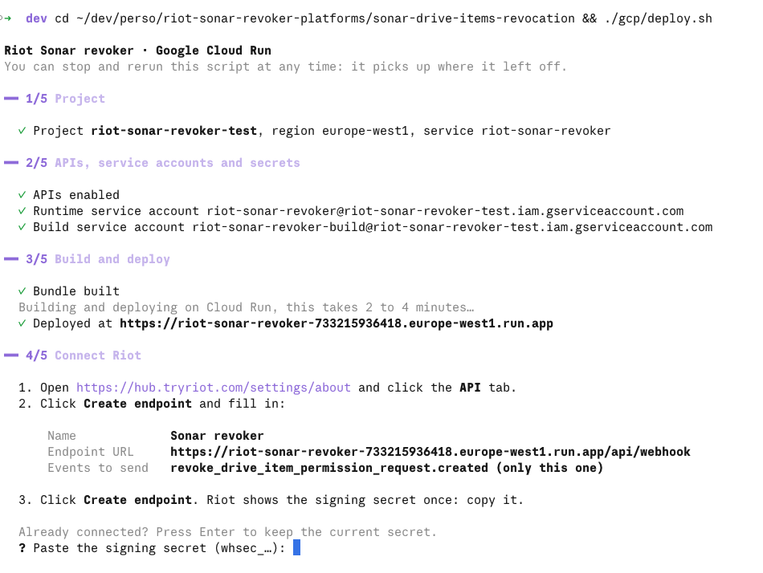
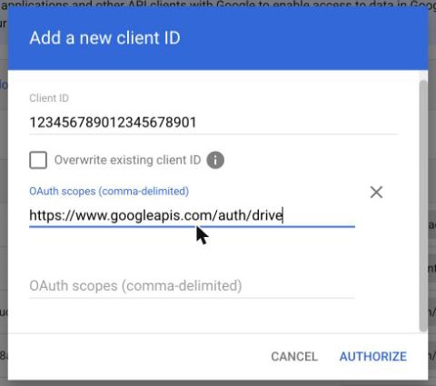

# Deploy on Google Cloud

The receiver runs on Cloud Run in your own Google Cloud project. It needs no key file: it runs as its own service account and signs its domain-wide delegation tokens through the IAM Credentials API.

One script does the whole setup. It walks you through five steps, and you can stop and rerun it at any time: it picks up where it left off.

## Before you start

- **A Google Cloud project with billing enabled**, where you are Owner. To create one, you need the Project Creator role on the organization and Billing Account User on a billing account: [create a project](https://console.cloud.google.com/projectcreate), then [link it to billing](https://console.cloud.google.com/billing/linkedaccount). Usage stays within the free tier for normal revocation volumes.
- **A Google Workspace super admin**, for the domain-wide delegation step.
- **A Riot admin**, to create the webhook endpoint in the Riot hub.

## Deploy

1. Open [Cloud Shell](https://shell.cloud.google.com) and select the project:

   ```bash
   gcloud config set project <project-id>
   ```

2. Run the script:

   ```bash
   git clone https://github.com/tryriot/riot-functions && ./riot-functions/sonar-drive-items-revocation/gcp/deploy.sh
   ```

   - To also handle Microsoft 365, prefix the command with `MS_TENANT_ID=<tenant> MS_CLIENT_ID=<client>`. The script then asks for the client secret.
   - `REGION` defaults to `europe-west1`, `SERVICE` to `riot-sonar-revoker`.

<details>
<summary>Run it from your own machine instead of Cloud Shell</summary>

You need the Google Cloud CLI, curl and unzip:

```bash
brew install --cask google-cloud-sdk   # or https://cloud.google.com/sdk/docs/install
gcloud auth login
gcloud config set project <project-id>
git clone https://github.com/tryriot/riot-functions
cd riot-functions/sonar-drive-items-revocation && ./gcp/deploy.sh
```

</details>

## What the script walks you through



### 1/5 Project

The script checks that the project exists, that your account can access it, and that billing is on. If any of these fails, it stops and says what to fix.

### 2/5 APIs, service accounts and secrets

The script enables the APIs and creates two service accounts: one the receiver runs as, and one that builds the container. Nothing to do on your side.

### 3/5 Deploy

The script downloads the release and deploys it on Cloud Run, which builds the container. This takes 2 to 4 minutes. At the end it prints the service URL, for example `https://riot-sonar-revoker-123456789012.europe-west1.run.app`.

### 4/5 Connect Riot

The script prints the webhook URL and the values to enter in Riot. Riot only shows the signing secret once the endpoint exists, which is why this step comes after the deploy.

1. Open the [Riot hub settings](https://hub.tryriot.com/settings/about) and click the **API** tab.
2. Under **Webhooks**, click **Create endpoint** and fill in:
   - **Name:** `Sonar revoker`
   - **Endpoint URL:** the webhook URL printed by the script, ending in `/api/webhook`
   - **Events to send:** tick only `revoke_drive_item_permission_request.created`

   

3. Click **Create endpoint**. Riot shows the signing secret (`whsec_…`) once. Copy it, then click **I saved the secret**.

   

4. Paste the secret into the script. It stores the secret in Secret Manager and redeploys the service.

### 5/5 Allow access to Google Drive

The script prints the client ID of the service account.

1. As a Google Workspace super admin, open [domain-wide delegation](https://admin.google.com/ac/owl/domainwidedelegation). The menu path is **Security > Access and data control > API controls > Manage domain-wide delegation**.
2. Click **Add new** and fill in:
   - **Client ID:** the one printed by the script
   - **OAuth scopes:** `https://www.googleapis.com/auth/drive`

   

3. Click **Authorize**, then press Enter in the script.

The script ends with a check of the service. Each part shows ✓ when configured, or "not configured" when unused (Microsoft 365 when you only use Google):

```
━━ Check

  ✓ Riot signing secret
  ✓ Google Workspace
  – Microsoft 365 not configured
```

## Test from Riot

1. In the Riot **API** tab, click **⋯** on the endpoint, then **Send test**.

   

2. Pick `revoke_drive_item_permission_request.created` and click **Send test**.
3. Riot must show **Your endpoint accepted the test** with a 200. A test event never revokes anything. If Riot shows **Your endpoint rejected the test**, see [Troubleshooting](#troubleshooting).

The test only proves that Riot reaches the receiver and that the signing secret matches. To check Drive access for a real user:

```bash
curl -X POST https://<service-url>/api/check -H 'content-type: application/json' \
  -d '{"provider":"google","email":"someone@yourdomain.com"}'
```

## Go live

Ask your Riot account manager to switch Sonar revocations to webhook mode. Each revocation then shows up in the [Cloud Run logs](https://console.cloud.google.com/run) with the status `revoked`, `already_gone` or `skipped`.

## Update

Pull the repository and run the script again. It reuses what already exists. It asks for the signing secret again: press Enter to keep the current one. Microsoft settings already on the service are kept when `MS_CLIENT_ID` is not set.

## What the script creates

- APIs: Cloud Run, Cloud Build, Artifact Registry, IAM Credentials, Drive, Secret Manager.
- Service account `riot-sonar-revoker`, which the receiver runs as. It may sign tokens for itself only.
- Service account `riot-sonar-revoker-build`, with the Cloud Build builder role. It builds the container.
- Artifact Registry repository `cloud-run-source-deploy`, holding the built image.
- Secret Manager secrets `sonar-revocation-riot-secret` and, with Microsoft 365, `sonar-revocation-ms-secret`.
- Cloud Run service `riot-sonar-revoker`, reachable from the internet, up to 5 instances. It skips the Cloud Run invoker check (`--no-invoker-iam-check`), so it works in organizations that forbid public IAM bindings. Every webhook is still checked against the Riot signature.

## Troubleshooting

### Deploy

| The script says | Fix |
| --- | --- |
| `No project selected` | Run `gcloud config set project <project-id>`. |
| `Project … not found, or … can't access it` | Check the project ID with `gcloud projects list`. If you have several accounts, check which one is active with `gcloud config get-value account`. |
| `Billing is off for …` | Open the link the script prints and link a billing account. |
| `PERMISSION_DENIED` on `storage.objects.get` during the build | You ran an older version of the script. Pull the repository and rerun it: the build now uses its own service account. Right after it is created, rights can take a minute to apply. If the error persists, wait a minute and rerun. |
| `constraints/run.managed.requireInvokerIam` | Your organization forbids public Cloud Run services. Ask an organization admin to exempt this project from that policy. |

### Webhook

Riot shows the HTTP status of the receiver in **Send test**, and in each delivery under **⋯ > View details**.

| Riot shows | Cause | Fix |
| --- | --- | --- |
| **403** | Cloud Run blocks the request before the receiver: the service still requires invoker IAM. An older version of the script used `--allow-unauthenticated`, which organizations with domain-restricted sharing reject without failing the deploy. | Rerun the script, or run `gcloud run services update riot-sonar-revoker --region europe-west1 --no-invoker-iam-check`. |
| **404** | The endpoint URL is wrong. | Edit the endpoint in Riot: the URL must end in `/api/webhook`. |
| **401** `no matching signature` | The secret in Secret Manager is not this endpoint's secret, for example after recreating the endpoint in Riot. | Rerun the script and paste this endpoint's secret. |
| **500** `RIOT_WEBHOOK_SECRET is not configured` | The secret was never pasted, for example after stopping the script at step 4. | Rerun the script and paste the secret. |
| **500** `configuration` with `Google token exchange failed` | Domain-wide delegation is missing, has the wrong client ID or the wrong scope, or is not active yet. It can take a few minutes to apply. | Redo step 5 with the client ID printed by the script and the exact scope `https://www.googleapis.com/auth/drive`. |
| **503** | Google or Microsoft is rate limiting or down. | Nothing to do: Riot retries the delivery. |
| **Timeout** or no answer | The service is not deployed, or was deleted. | Run `curl https://<service-url>/`, then rerun the script. |

To see what the receiver logged:

```bash
gcloud run services logs read riot-sonar-revoker --region europe-west1 --limit 50
```

Then follow [Verify a deployment](../README.md#verify-a-deployment) for more checks.
